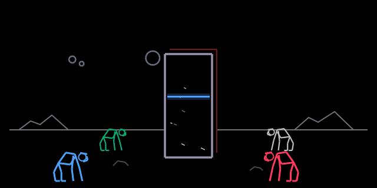
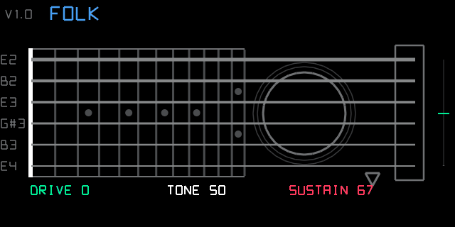
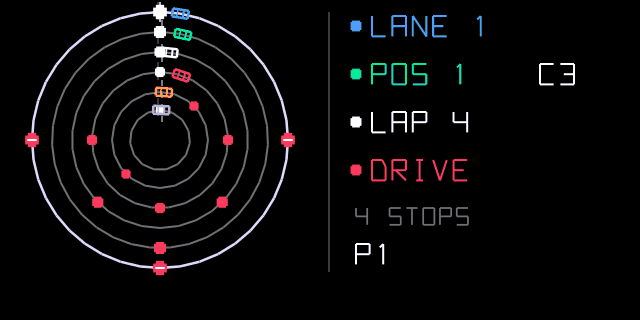
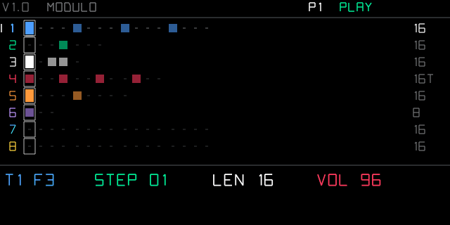

# OP-1-KumaSaru

A suite of custom synth engines and sequencers for the original **Teenage Engineering OP-1** running the [op1r](https://github.com/pcppcp/op1r)
firmware (R246), written with the synth SDK from [op1r-src](https://github.com/pcppcp/op1r-src).

| | name | what it is |
|---|---|---|
| synth | [Monolith](monolith/README.md) | techno / industrial drone engine, 2001 screen |
| synth | [AirGuitar](airguitar/README.md) | six strings strummed by moving the OP-1 (accelerometer) |
| sequencer | [Track Racer](trackracer/README.md) | circular sequencer: cars on six lanes with their own lap |
| sequencer | [Star-Roll](starroll/README.md) | random note generator with ranges on LED gauges and a star field |
| sequencer | [Modulo](modulo/README.md) | polyrhythmic step sequencer: 8 tracks with their own length and step size |

# Synths

Synth engines, chosen like the built-in ones (op1r 44).

## Monolith

A techno / industrial drone engine: long pads that never repeat, for techno and progressive tracks. TONE, MOTION,
RUST and THICKNESS on the four knobs; three slow LFOs with incommensurate periods and three random walks keep it
moving. The screen is after *2001: A Space Odyssey*: four hominids (one per knob) walk up to the monolith as the
values rise, and three moons are the live LFOs. Details: [`monolith/README.md`](monolith/README.md).

## AirGuitar

A synth engine you play by **strumming the OP-1 through the air**: hold a chord on the keys and move the OP-1 down
or up; the accelerometer turns the motion into a strum across six Karplus-Strong strings. Eight guitars (classical,
flamenco, folk, jumbo, jazz archtop, clean and crunch electric, banjo), drive, tone, sustain / palm mute; page 2 sets
how hard a stroke must be and the play mode (gesture only, or gesture + keys). The screen is the neck seen by the
player, the 1st string at the bottom. Details: [`airguitar/README.md`](airguitar/README.md).

# Sequencers

Extra sequencers, chosen like the built-in ones (endless, tombola…) and the op1r ones (euclid…). They work in synth
and drum mode and use op1r-style Shift + key shortcuts (start / stop and more: see each page).

## Track Racer

A circular sequencer after Google's *Racer* with Giorgio Moroder: six concentric lanes, a car on each, and a lane
plays when its car drives over a **stop sign**. Each lane has its own lap length (polyrhythms), 64 positions per lap,
step and live recording, 4 patterns, mutes. Details: [`trackracer/README.md`](trackracer/README.md).

## Star-Roll

A random note generator: eight ranges (rate, gate, pitch, leap, velocity, rests, phrase memory, chords) on LED gauges,
in a scale, and in the middle a star field where every note played becomes a star scrolling from right to left
(height = pitch, size = velocity, trail = length, red = from the memory). Details: [`starroll/README.md`](starroll/README.md).

## Modulo

A polyrhythmic step sequencer: eight tracks of steps, each with its own length (1–32) and step size (1/32 to 1/4,
triplets), so the rows drift against each other; accents, volume and mute per track, 4 patterns, step and live
recording. Details: [`modulo/README.md`](modulo/README.md).

# The project

## Layout

    monolith/        synth: monolith.c, monolith.svg, plugin.json, long-render harness
    airguitar/       synth: airguitar.c, airguitar.svg, plugin.json, host test + preview + demo (test/)
    trackracer/      sequencer: trackracer.c, trackracer.svg, plugin.json, host test + preview (test/)
    starroll/        sequencer: starroll.c, starroll.svg, plugin.json, host test + preview (test/)
    modulo/          sequencer: modulo.c, modulo.svg, plugin.json, host test + preview (test/)
    demos/           screen previews and animations, audio renders (mp3), monolith spectrogram
    release/         monolith.op1p, track_racer.op1p, star-roll.op1p, airguitar.op1p, modulo.op1p, ready to install (op1r 34+;
                     airguitar needs op1r 44 for its 8-step guitar knob)
    tools/           firmware bundle (make_bundle.py), animated monolith preview (make_anim.py)
    setup.sh         links the plugins into an op1r-src checkout

## Development

    ./setup.sh                                   # clones op1r-src next to this repo and links the plugins
    cd ../op1r-src/synth_sdk
    python3 harness/audio.py monolith            # sanitizer test -> WAV
    python3 harness/render.py monolith           # screen preview -> PNG
    python3 make_plugin.py monolith "track racer" star-roll airguitar modulo   # -> build/plugins/*.op1p (bfin-elf toolchain)
    python3 ../../OP-1_KumaSaru/trackracer/test/render_trackracer.py ..   # track racer host test + preview

## Firmware bundles

Bundles are named `op1r44_KumaSaru_<version>.op1`: op1r 44 with all its official plugins (every file
byte-identical) plus every plugin in `release/` (bundles up to 0.7 were first named `op1r44_SceriffoRosso_<version>.op1`):

    python3 tools/make_bundle.py <version> <op1r 44 .op1> <op1r checkout> [out dir]

| version | contents |
|---|---|
| 0.3 | monolith (2001 screen), Track Racer V1.2, Leapfrog V1.0 |
| 0.4 | monolith, Track Racer V1.2, Star-Roll V1.0 (replaces Leapfrog) |
| 0.5 | Star-Roll V1.1: AIR and MEM are ranges like the others; phrase length on Shift + lift |
| 0.6 | + AirGuitar V1.0 (monolith, Track Racer V1.2, Star-Roll V1.1 unchanged) |
| 0.7 | + Modulo V1.0 |

## Installing on the OP-1

With op1r 34 or newer, either:

- **USB**: op1r web patcher, **Connect OP-1**, "own plugin files", pick the `.op1p` files; the OP-1 asks for
  confirmation (T1 restarts and applies), or
- **firmware file**: add the `.op1p` files under `plugins/` in an op1r `.op1` image and install it from te-boot
  (hold COM while switching on) like any OP-1 update.

## License

GPL-3.0-or-later, with op1r's additional permission to combine it with the OP-1 firmware (see
[op1r-src NOTICE](https://github.com/pcppcp/op1r-src/blob/main/NOTICE)). Independent project, not affiliated with
Teenage Engineering. OP-1 is a trademark of Teenage Engineering AB.
