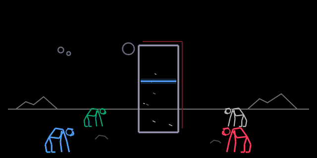
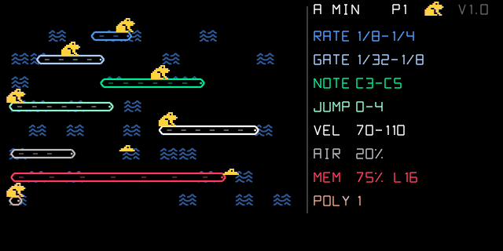

# OP-1 Monolith

Custom synth engines and sequencers for the original **Teenage Engineering OP-1** running the [op1r](https://github.com/pcppcp/op1r)
firmware (R246), written with the synth SDK from [op1r-src](https://github.com/pcppcp/op1r-src).

## monolith

A techno / industrial drone engine: long pads that never repeat, for techno and progressive tracks.

| knob | name | what it does |
|---|---|---|
| blue | tone | filter opening, from dark to bright (50 % key tracking) |
| green | motion | how much and how fast the drone evolves (0 = static) |
| white | rust | inharmonic ring mod, wavefolder, hiss |
| red | thickness | detune of the 3 saws and sub level |

### Screen

Inspired by *2001: A Space Odyssey*: a monolith (4:9 proportions) in the middle and **four hominids**, one per knob
in its colour. The higher the value, the closer the hominid walks to the monolith; at the top of the range it
**touches** it. Blue and green stand on the left, white and red on the right. Everything else follows the drone's
live state: **three moons** = the three slow LFOs (now and then they line up above the monolith), **blue line** =
the live filter position, **white scratches** = rust, **red depth edge** of the monolith = detune.

90-second audio demos (knobs untouched): [`demos/`](demos/). Technical details: [`monolith/README.md`](monolith/README.md).

## Track Racer

A circular sequencer after Google's *Racer* with Giorgio Moroder: six concentric lanes, a car on each, and a lane
plays when its car drives over a **stop sign**. Each lane has its own lap length (polyrhythms), 64 positions per lap,
step and live recording, 4 patterns, mutes; synth and drum mode. Details: [`trackracer/README.md`](trackracer/README.md).

## Leapfrog

A random note generator where every parameter is a range drawn as a log on a river, and a frog on each log jumps to
the value drawn at each note: rate, gate, pitch range, leap size, velocity, rests, phrase memory and chords, in a
scale. 8-bit arcade look. Details: [`leapfrog/README.md`](leapfrog/README.md).

## Layout

    monolith/        synth engine: monolith.c, monolith.svg, plugin.json, long-render harness
    trackracer/         sequencer: trackracer.c, trackracer.svg, plugin.json, host test + preview (test/)
    demos/           PC renders (mp3), spectrogram, screen preview and animation
    release/         monolith.op1p, track_racer.op1p and leapfrog.op1p, ready to install (op1r 34+, plugin API 1)
    tools/           animated screen preview (make_anim.py)
    setup.sh         links the plugins into an op1r-src checkout

## Development

    ./setup.sh                                   # clones op1r-src next to this repo and links the plugins
    cd ../op1r-src/synth_sdk
    python3 harness/audio.py monolith            # sanitizer test -> WAV
    python3 harness/render.py monolith           # screen preview -> PNG
    python3 make_plugin.py monolith "track racer" leapfrog      # -> build/plugins/*.op1p (bfin-elf toolchain)
    python3 ../../OP-1_Monolith/trackracer/test/render_trackracer.py ..   # track racer host test + preview

## Installing on the OP-1

With op1r 34 or newer, either:

- **USB**: op1r web patcher, **Connect OP-1**, "own plugin files", pick the `.op1p` files; the OP-1 asks for
  confirmation (T1 restarts and applies), or
- **firmware file**: add the `.op1p` files under `plugins/` in an op1r `.op1` image and install it from te-boot
  (hold COM while switching on) like any OP-1 update.

## License

GPL-3.0-or-later, with op1r's additional permission to combine it with the OP-1 firmware (see
[op1r-src NOTICE](https://github.com/pcppcp/op1r-src/blob/main/NOTICE)). Independent project, not affiliated with
Teenage Engineering. OP-1 is a trademark of Teenage Engineering AB.
