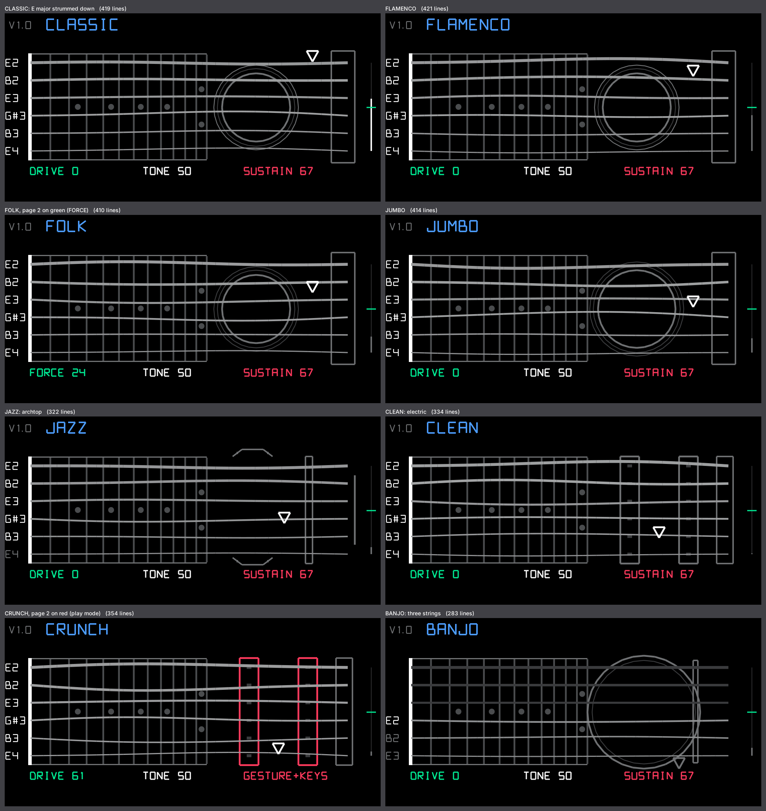

# AirGuitar — strum the OP-1 like a guitar (op1r synth engine)

Six plucked strings (Karplus-Strong). Hold a chord on the keys, then **move the OP-1 down or up through the air**:
the accelerometer turns the motion into a strum. A stroke down plays the strings from the lowest note to the highest,
a stroke up the other way round, a few ms apart; a faster stroke is tighter and louder. Each held note is one string
(6 voices = 6 strings).

## Knobs

| knob | page 1 | page 2 (press the knob) |
|---|---|---|
| blue (8 steps) | guitar: CLASSIC, FLAMENCO, FOLK, JUMBO, JAZZ, CLEAN, CRUNCH, BANJO | — |
| green | drive (soft clip per string) | FORCE: how hard a stroke must be (0 = light, the default) |
| white | tone: soft (plucked over the neck) .. bright (near the bridge) | — |
| red | sustain: palm-muted (MUTE, left) .. ringing | play mode: GESTURE (left half, default) or GESTURE+KEYS |

- **GESTURE**: the keys only fret the strings; nothing sounds until you strum. Pressing new keys after a stroke
  does not make them sound by themselves.
- **GESTURE+KEYS**: a key also plucks its string at once (with its velocity), and strokes strum all held strings.

Reverb and delay come from the op1r effects (instrument FX, master FX): one effect for all six strings, as on a
guitar rig. Envelope (T2): attack at 0, sustain up; lifting the keys stops the strings, like lifting the fretting
hand. With the op1r **chord** sequencer one key gives a whole chord.

## Screen

The neck as the player sees it, with the **6th string (lowest) at the top and the 1st at the bottom**. A held note
takes a string by its pitch (the lowest held note on the lowest string used) and its name shows at the nut. Strings
vibrate and light up with their sound. The body changes with the guitar (soundhole and rosette, archtop f-holes,
pickups — red for CRUNCH —, banjo head). The pick sweeps across the strings on each stroke. The bar at the right edge
is the stroke meter: the motion in progress against the FORCE threshold (green tick); use it to set FORCE.

Audio demo (PC render, strummed eighths, four chords per guitar): [`demos/airguitar_strum.mp3`](../demos/airguitar_strum.mp3).

## How the strum is detected

Once per sensor reading (~69 Hz): the reading minus a gravity estimate (~0.2 s average), projected on gravity, is
integrated into a velocity along the vertical (so it works however the OP-1 is held). A stroke fires when that
velocity crosses the threshold while rising, and re-arms when it falls or turns round. A stroke the other way needs
~145 ms since the last one: the sensor clips at 2 g, so the braking of a hard isolated stroke looks like a stroke
back. Simulated: alternating eighths from 70 to 160 BPM at 0.3–2 g are all caught; turning or tilting the OP-1
never fires; sideways motion does not strum.

## Sound

Per string: a 4096-sample delay line (down to ~11 Hz) with linear interpolation, loop filter (two-point average
blended by the tone, then a one-pole low-pass, its delay compensated: tuning within 2 cents from E2 to C6), loss per
pass scaled by the period (each guitar has its own ring time: banjo ~1.7 s, classical ~4 s, electric ~6 s on A2),
a body resonance (state-variable band-pass, ~100 Hz for the classical), a DC blocker and a soft-clip drive. A pluck
is a burst of low-passed noise (pick hardness) with a comb for the pluck position, mixed over 20 % of what still
rings. Integer only, no libc, one division per block.

## Test

    python3 airguitar/test/render_airguitar.py <op1r-src>    # host test (sanitizers) + preview, animation, demo

Checks: silence until a stroke; down = low → high, up = high → low, once per stroke; continuous strumming at
70/110/150 BPM alternates; OP-1 on its side; noise and slow tilting never fire; FORCE; GESTURE+KEYS; tuning for every
guitar, tone and sustain; palm mute; output range with drive; the screen stays above y = 140.
