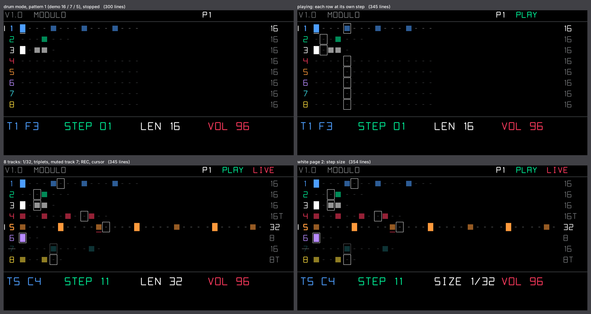

# Modulo — a polyrhythmic step sequencer for the OP-1 (op1r)

Eight tracks of steps. Every track has **its own length (1–32 steps) and its own step size**; its playhead is
*(steps since PLAY) mod length*, so a 16-step kick, a 7-step snare and a 5-step hat drift against each other and line
up again every 16 × 7 × 5 steps. Works in synth and drum mode.

## Tracks
- **8 tracks**, each one sound: in drum mode a drum key of the kit (kick, snare, hats…), in synth mode a note.
- **Length** 1–32 steps, **step size** 1/32, 1/16, 1/8, 1/4, 1/16T, 1/8T (triplets).
- **Steps**: off, on (the track volume) or **accent** (volume + 32). Notes last half a step.
- **Volume** 1–127 and **mute** per track; 4 patterns.
- Drum pattern 1 comes with a demo: four on the floor (16 steps), snare on a 7-step loop, hat on a 5-step loop.

## Controls (modulo screen)
| control | turn | press |
|---|---|---|
| blue | track 1–8 | **PLAY / STOP** (from step 1) |
| green | cursor (Shift: 4 steps) | the step under the cursor: off → on → accent → off |
| white | length 1–32 | page 2: step size (SIZE) |
| red | volume | mute / unmute the track |

| key | does |
|---|---|
| REC | record on / off |
| note key | REC on, stopped: the key becomes the track's sound and sets the step at the cursor, the cursor moves on · REC on, playing: **live**, the key becomes the sound and sets the nearest step (it does not play twice) · REC off: just plays |
| scissors | clear the step under the cursor · Shift: clear the track |
| lift / drop | copy / paste the track · Shift: the whole pattern |

Any screen, while modulo is the mode's sequencer: Shift + F G A B = pattern 1–4 · Shift + E F G A B C D E (from the
E in the middle of the keyboard) = mute track 1–8 · Shift + D# = mute all / none · Shift + C# = PLAY / STOP (with REC
held: also starts the tape). The tempo is the OP-1's; MIDI START restarts from step 1.

Everything is saved on the OP-1 (DB table `moduloseq`); it comes back stopped.

## Screen
One row per track, only as long as the track (the rows end at different places: the polyrhythm is the picture),
steps in groups of four: a dim dot = off, a block in the track's colour = on, a taller brighter block = accent. A white
frame marks each row's playhead and a step flashes white when it plays. Left: track numbers in their colours (muted:
dark and crossed out; the selected one marked), right: each track's step size. Under the cursor a bar (red while
recording). Bottom line in the encoder colours: track + sound, step, length (page 2: SIZE), volume (or MUTE); top
right: pattern, PLAY, REC / LIVE.

## Testing on a PC
    python3 modulo/test/render_modulo.py <op1r-src>     # host test (sanitizers) + screen preview + animation

Checks: timing of every step size, 16 / 7 / 5 polyrhythm meeting again after 560 steps, length and step size changes
while playing (no gap, no retrigger), accent / volume, gate, nothing hanging after STOP, mutes, patterns, step entry,
live record, copy / paste, MIDI start, the drum demo, save / load round trip, the screen above y = 140.
