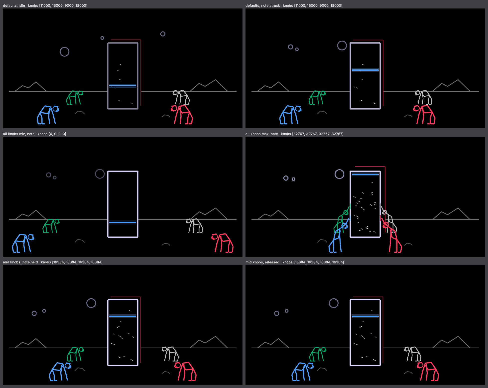
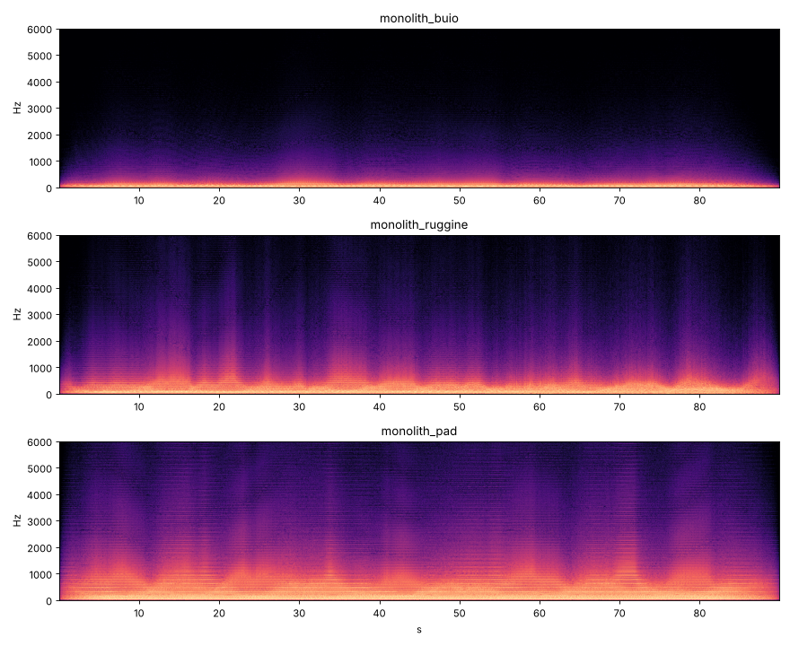

# Monolith — a techno / industrial drone engine for the OP-1 (op1r)

Long drones that never repeat, made to sit under techno and progressive tracks. Hold one or two low notes and let it
evolve: the movement comes from slow LFOs and random walks that keep running from one note to the next.

## Knobs
| knob | name | what it does |
|---|---|---|
| blue | TONE | filter opening, from dark to bright (25 Hz – 5 kHz, 50 % key tracking) |
| green | MOTION | how much and how fast the drone evolves (0 = static) |
| white | RUST | inharmonic ring mod, wavefolder and hiss: from clean to industrial |
| red | THICKNESS | detune of the 3 saws and level of the sub one octave down |

Tips: on the T2 page set a long attack and release; hold one or two low notes (or keep them held with a sequencer).
The op1r FX (tape echo, reverb) widen it further.

## Screen
After *2001: A Space Odyssey*: a monolith (4:9 proportions) in the middle and **four hominids**, one per knob in its
colour. The higher the value, the closer the hominid walks to the monolith; at the top of the range it **touches**
it. Blue and green stand on the left, white and red on the right. Everything else follows the drone's live state:

- **three moons** = the three slow LFOs, rising and setting over the horizon (now and then they line up above the
  monolith);
- **blue line** on the monolith = the live filter position;
- **white scratches** = rust;
- **red depth edge** of the monolith = detune.

## Sound
Per voice: 3 saws (root, + spread, − spread) + a square one octave down → ring mod with a sine at a drifting
non-integer ratio → wavefolder → noise → resonant state-variable low-pass → soft clip.

Why it never repeats: the cutoff, the resonance, the beating speed of the detuned saws, the ring ratio and a tiny
pitch drift are driven by **three slow sine LFOs with incommensurate periods** (about 23.7 s, 37.1 s and 61.3 s at
MOTION 37 %, faster above, slower below) plus **three random walks** that pick a new target at random intervals and
glide to it. The modulation state lives per voice and keeps running across notes, so a drone played again does not
restart from the same point.

Integer only (Q15), no per-sample division, no 64-bit math, no libc; every multiply is bounded so it cannot overflow.

## Audio demos
90-second PC renders, knobs untouched (in [`demos/`](../demos/)):

| file | sound |
|---|---|
| [`monolith_dark.mp3`](../demos/monolith_dark.mp3) | low TONE: a dark, closed drone |
| [`monolith_pad.mp3`](../demos/monolith_pad.mp3) | a pad in the middle of the ranges |
| [`monolith_rust.mp3`](../demos/monolith_rust.mp3) | high RUST: ring mod, folding and hiss |

## Testing on a PC
    python3 ../../harness/audio.py monolith                      # official harness test (sanitizers) -> WAV
    ./render_demo.sh dark 90 7000,14000,4000,20000 7000,14000,4000,20000 24,36   # long render
    python3 ../../harness/render.py monolith                     # screen preview (PNG)
    python3 ../tools/make_anim.py <op1r-src>                     # animated preview (GIF)

(paths from `op1r-src/synth_sdk/plugins/monolith` after `./setup.sh`)

## Status
V1.0. Runs on the OP-1 with op1r 44. Audio and screen are tested on the PC with ASan + UBSan (no overflows, no
clicks). The plugin file is built with bfin-elf gcc 12.3 (the same toolchain builds op1r's own plugins
byte-identical). `order` is 99 in `plugin.json`: plugin files get their number from the loader; a final number would
be assigned by the op1r maintainers if the plugin is submitted upstream.
