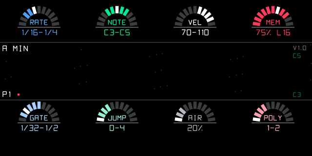

# Star-Roll — a random note generator for the OP-1 (op1r)

Eight parameters, each a **range** on an LED gauge (four on top, the Shift ones below), and in the middle a **star
field** that scrolls from right to left: one star for every note played, a piano roll in space. Synth and drum mode.

## Parameters
| gauge | encoder | range |
|---|---|---|
| RATE | blue | time to the next note, 1/64 .. 16 bars |
| NOTE | green | pitch range C1 .. C7, taken from the scale |
| VEL | white | velocity 1 .. 127 |
| MEM | red | memory: chance that a note repeats the phrase (100 % = a loop, 0 % = always new) |
| GATE | Shift + blue | note length, 1/64 .. 16 bars |
| JUMP | Shift + green | leap from one note to the next, 0 .. 12 scale steps (up or down; reflected at the range edges) |
| AIR | Shift + white | chance of a rest, 0 .. 100 % |
| POLY | Shift + red | notes per hit 1 .. 4 (chords of stacked thirds) |

**Turn** an encoder to move the range (its centre, the target). **Press** it to edit the width (the gauge's baseline
lights up with `< >`): turning then makes the range longer or shorter around its centre. With Shift held, turn /
press work on the Shift gauge. On a gauge, the lit segments are the range and the white one is the value drawn for
the latest note (always inside the range shown). AIR and MEM are ranges of chances too: each note draws its chance
of a rest / of the memory inside the range (that is the white segment); whether it happened shows in the star field.

## Star field
- one star per note, born at the right edge when it sounds; the field shows the last 2 bars
- height = the pitch inside the NOTE range of that moment (the range is in the right corners)
- size = velocity; trail = the note's real length (it grows out of the right edge while the note sounds)
- white = a new note, red = repeated from the memory, yellow = the root of the scale
- faint lines join the notes in order (the leaps); chords stack up; long loud notes become planets with a ring
- rests leave the sky empty; slow dust drifts behind; a red dot next to the pattern blinks on the beat

## Keys (star-roll screen)
| key | does |
|---|---|
| note key | root of the scale (drum mode: the scale picks the pads) |
| drop / Shift + drop | next / previous scale: MAJ MIN DOR PHR PEN+ PEN- |
| lift | start / stop |
| Shift + lift | phrase length of the memory: 4 / 8 / 16 / 32 notes |
| scissors | new phrase (forget the memory) |

Any screen while star-roll is the sequencer: Shift + F G A B = pattern 1–4 (all parameters + scale), Shift + C# =
start / stop (with REC held: also starts the tape). Patterns are saved on the OP-1 (DB table `starrollseq`).

## Testing on a PC
    python3 test/render_starroll.py ../../op1r-src     # host test (sanitizers) + preview + animation

Checks: rates and the 1/16 grid, notes in the scale and range, JUMP 0 / exact leaps, AIR 0 / 100, MEM 100 looping
with its phrase length and MEM 0 drawing anew, POLY chords, gates, the 6-voice limit, nothing hanging after stop,
range move / width / clamps, root and scales, patterns, Shift + C#, MIDI start, drum pads, save / load, one star per
note with its height and flags, planets, MIDI start clearing the sky, nothing drawn below y = 140.
